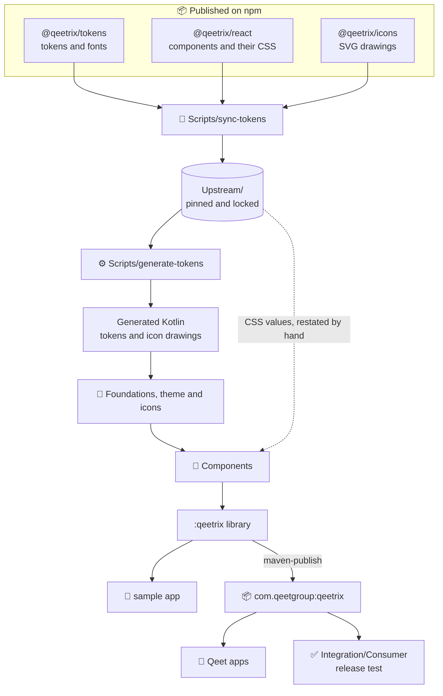
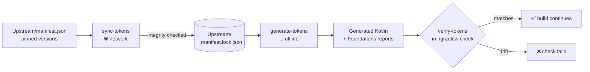
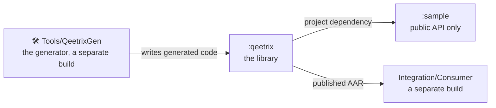
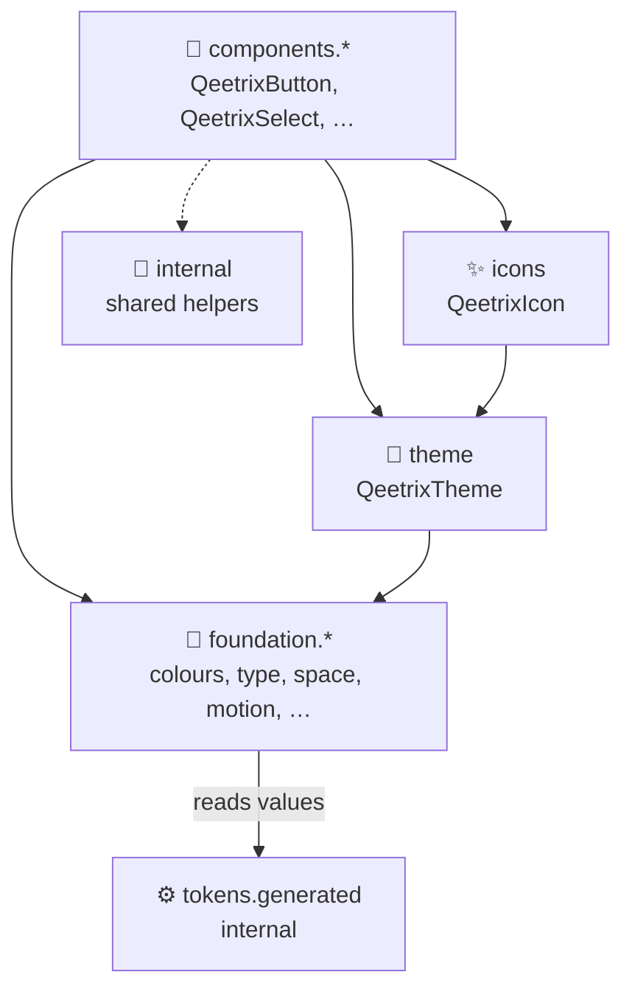

# 🏗️ Architecture

How Qeetrix for Android turns the published Qeetrix packages into a Compose library, and the rules that keep it that
way. The reasons behind each choice are in the [decision records](Documentation/Decisions/README.md).

## 🗺️ The big picture

Nothing visual is decided here. Tokens, fonts, icons and component looks come from the web's npm packages. They are
synced, locked and turned into Kotlin, and the components are built on top.

## 🔄 From npm to Kotlin

| Step | Command | What it does |
|:--|:--|:--|
| **Sync** | `Scripts/sync-tokens` | Fetches the three pinned packages and checks each against the npm registry's integrity hash. Copies the token build, the native fonts, the component CSS and the icon drawings into `Upstream/`, and records every file's hash in the lock. |
| **Generate** | `Scripts/generate-tokens` | Reads only `Upstream/` and writes the generated Kotlin and the reports. The same input always gives the same bytes. |
| **Verify** | `Scripts/verify-tokens` | Part of `./gradlew check`. Fails if a locked file changed or a generated file differs from a fresh generation. |

**How the web's values map to Android:**

| Web | Android |
|:--|:--|
| 1 px | 1 dp |
| 1 rem | 16 dp |
| Font size | sp, so it follows the user's font size |
| Line height · letter spacing | A multiple of the size · em |
| Colour (OKLCH) | sRGB, or Display P3 when outside sRGB ([0005](Documentation/Decisions/0005-colour-conversion-per-css-color-4.md)) |
| Duration | ms |

Every upstream token is either generated or excluded with a written reason
([Scope.kt](Tools/QeetrixGen/src/main/kotlin/com/qeetgroup/qeetrix/gen/tokens/Scope.kt)). An unknown token fails
generation, so a new upstream group is always a decision. The full map is in
[TOKEN_COVERAGE.md](Documentation/Foundations/TOKEN_COVERAGE.md).

## 🧱 Modules

| Unit | Uses | Never uses |
|:--|:--|:--|
| `:qeetrix` | Compose runtime, UI, foundation and animation. Internally, Material 3 for the date and time pickers and pull to refresh, and AndroidX Activity for the sheets' Back gesture | Material types in its API, networking, databases, image loading, navigation libraries |
| `:sample` | `:qeetrix`'s public API | `:qeetrix`'s internals |
| `Tools/QeetrixGen` | Kotlin and the JDK | Android or Node.js |
| `Integration/Consumer` | `com.qeetgroup:qeetrix` from a Maven repository, like a real app | The library's sources |

## 📦 Inside the library

**Generated code is never public.** The public types in `foundation` and `theme` are written by hand, and the
generated code fills them in by name. If a token is added or removed upstream, the build fails to compile until
someone changes the public API on purpose.

| Part | In short |
|:--|:--|
| 🎨 **Theme** | `QeetrixTheme(mode)` picks light or dark and provides colours, type, density and reduced motion through composition locals. No global state, no Material ([0006](Documentation/Decisions/0006-theming-through-composition-locals.md)). |
| 🔤 **Typography** | The web's own font files (Qeet Sans, Fira Code), with each role's weight, letter style and optical size ([0007](Documentation/Decisions/0007-fonts-are-the-webs-fonts-in-native-format.md)). |
| 🌫️ **Shadows** | Only floating layers have them, drawn the way CSS `box-shadow` draws. |
| ✨ **Icons** | SVGs turned into Compose paths by the generator, tinted with the content colour, mirrored in right to left where the meaning has a direction ([0008](Documentation/Decisions/0008-icons-are-generated-vector-paths.md)). |

## 🧩 How a component is built

Each component is one file in `components.<family>`, the counterpart of an `@qeetrix/react` component
([COMPONENT_CONTRACT.md](Documentation/Standards/COMPONENT_CONTRACT.md)):

- **Compose foundation, not Material.** It uses `BasicText`, `BasicTextField`, `Popup`, `Dialog` and `Canvas`. The only
  exceptions are the date and time pickers and pull to refresh, and `MaterialBoundaryTest` keeps it that way.
- **The app owns the state.** Values, selections and `open` flags come in as parameters, with `@qeetrix/react`'s
  names. Qeetrix never owns navigation or data.
- **Values come from the theme and the CSS.** Anything the tokens don't name is restated from the family's CSS, with
  the CSS beside each literal.
- **It ships complete:** tests, a screenshot test, a sample page, a documentation page and an entry in the API
  baseline. `Scripts/new-component` creates all of them.

## 🌉 Web and iOS

- **The web is the authority.** Tokens, fonts and icons change only upstream and arrive here by a pin bump.
- **iOS** pins the same packages and versions. The shared rules and the deliberate differences are in the
  [cross-platform contract](Documentation/CROSS_PLATFORM_CONTRACT.md).

## 📚 Go deeper

- 🧭 [Decision records](Documentation/Decisions/README.md): why each part is built the way it is
- 📏 [Standards](Documentation/Standards): the component contract, the public API, accessibility, forms, overlays
- 🎨 [Token coverage](Documentation/Foundations/TOKEN_COVERAGE.md): every upstream token and its Kotlin name
