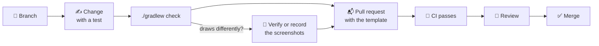
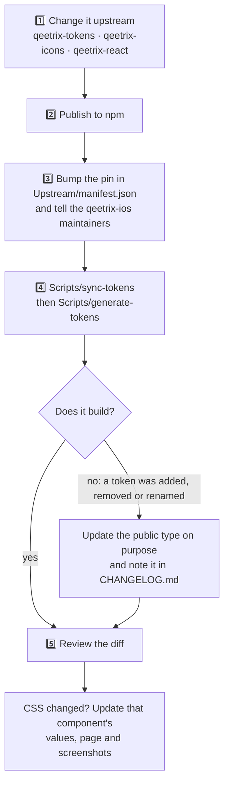
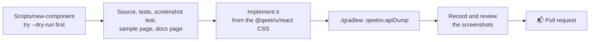
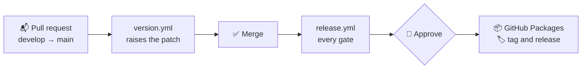

# 🤝 Contributing

Thanks for helping build Qeetrix for Android. This page covers setting up, the commands, and the three things you
are most likely to do: change something, change how something looks, and add a component.

## 🛠️ Setting up

- **JDK** 17 or newer (21 recommended).
- **Android SDK** with `platforms;android-37.0` and `build-tools;36.0.0`. Android Studio installs both. Set
  `ANDROID_HOME`, or put `sdk.dir=…` in `local.properties` (not committed).
- **Network**, only for the first dependency download and for `Scripts/sync-tokens`.

Open the repository root in Android Studio, or check that everything works from the command line:

```sh
./gradlew check
```

## 🔁 Making a change



- **One topic per pull request.** Fill in the template's checklist.
- **A maintainer reviews** changes to the public API, the generator's scope rules or a dependency. Anything
  structural also needs a [decision record](Documentation/Decisions/README.md).
- **Mirror cross-platform changes** (naming, conversion, scope) in qeetrix-ios, or record the difference in the
  [cross-platform contract](Documentation/CROSS_PLATFORM_CONTRACT.md).

## ⌨️ Commands

**Every day**

| Command | What it does |
|:--|:--|
| `./gradlew check` | Lint, ktlint, every JVM test, the generator's tests and drift check, the public API check |
| `./gradlew ktlintFormat` | Fix formatting |
| `./gradlew :sample:installDebug` | Install the sample app on a device or emulator |
| `./gradlew :qeetrix:assembleRelease` | Build the AAR |

**Screenshots and API**

| Command | What it does |
|:--|:--|
| `./gradlew :qeetrix:verifyRoborazziDebug` | Compare every screenshot with your local baselines |
| `./gradlew :qeetrix:recordRoborazziDebug` | Record the baselines. Review every image before relying on it. |
| `./gradlew :qeetrix:apiDump` / `apiCheck` | Update or check `Documentation/API/qeetrix.api` |
| `./gradlew :qeetrix:dokkaGenerate` | Build the API reference into `qeetrix/build/dokka/html` |

**Devices and releases**

| Command | What it does |
|:--|:--|
| `./gradlew :qeetrix:connectedDebugAndroidTest` | Device tests on every connected device or emulator, including the Accessibility Test Framework from API 36 |
| `Scripts/verify-aar qeetrix/build/outputs/aar/qeetrix-release.aar` | Check the AAR ships only what it should |
| `Scripts/release-candidate <X.Y.Z-rc.N> [--devices]` | Every release gate and a local publication ([checklist](Documentation/Releases/RELEASE-CHECKLIST.md)) |
| `./gradlew -p Integration/Consumer :app:assembleRelease` | Build the [independent consumer](Integration/Consumer/README.md) against a published candidate |

**Upstream and components**

| Command | What it does |
|:--|:--|
| `Scripts/sync-tokens [--check]` | Fetch and verify the pinned npm packages (network) |
| `Scripts/generate-tokens` | Regenerate everything made from `Upstream/` |
| `Scripts/verify-tokens` | Only the drift check |
| `Scripts/new-component <Family> <Component> --category "<group>" [--dry-run]` | Create a new component ([template](Templates/Component/README.md)) |

## 🎨 Changing how something looks

A colour, size, font, icon or component look is never changed here. It changes on the web first, then reaches
Android through a pin bump:



- **Never edit `Upstream/`, a `generated/` package or `Documentation/Foundations/` by hand.** `./gradlew check` fails
  if you do.
- **A new token group** fails generation until you add a rule for it in
  [Scope.kt](Tools/QeetrixGen/src/main/kotlin/com/qeetgroup/qeetrix/gen/tokens/Scope.kt), mirroring qeetrix-ios.
- **A new component family** gets its CSS by adding the family to `qeetrixReact.families` in `Upstream/manifest.json`.
- **A new icon:** add its name to `qeetrixIcons.icons`, sync, generate, then add it to `QeetrixIconName`.

## 🧩 Adding a component



`new-component` checks the name against `@qeetrix/react`'s component list and never overwrites a file. The new
component won't build until you implement it. Follow the
[component contract](Documentation/Standards/COMPONENT_CONTRACT.md): the web component's props, variants and states,
48 dp touch targets, and full TalkBack support.

## 🚀 Releasing

Like every Qeetrix package, **merging to `main` releases the version in `gradle.properties`**:



- **The version is in the pull request's diff.** `version.yml` raises the patch; raise the minor or major by hand.
- **The CHANGELOG entry** (`## [X.Y.Z] — YYYY-MM-DD`) becomes the GitHub Release's notes.
- **A bad release** is withdrawn with **Actions › Rollback**, and the fix is a new version.

The details are in [MAVEN-DISTRIBUTION.md](Documentation/Releases/MAVEN-DISTRIBUTION.md#publishing).

## ✍️ Code

- **Kotlin official style**, enforced by ktlint. Android Lint treats warnings as errors.
- **Explicit API mode**, with KDoc on everything public. Keep the public surface small
  ([PUBLIC_API.md](Documentation/Standards/PUBLIC_API.md)).
- **No literal colours, durations or fonts.** Use the foundation types. A size the tokens don't name comes from the
  component's CSS, with the CSS beside it.
- **No Material for appearance, no product-specific code, and no new runtime dependency** without a decision record.
- **Resource names start with `qx_`.**

## 🧪 Tests

- **New behaviour comes with a test that would fail without it.** Check values against an independent source, never a
  constant against itself.
- **Prefer JVM tests** (Robolectric and Compose UI Test) in `qeetrix/src/test`. Put what only a device can prove in
  `qeetrix/src/androidTest`, and say in the pull request whether you ran it.
- **Add a new component to the [quality catalogue](qeetrix/src/sharedTest/kotlin/com/qeetgroup/qeetrix/quality/QualityCatalog.kt)**,
  so the touch, clipping, contrast and accessibility scans cover it.
- **Screenshots stay on your machine.** They aren't committed and CI doesn't compare them. If your change alters how a
  component draws, run `verifyRoborazziDebug`. If the difference is intended, record, review each image, and say so in
  the pull request.

## ♿ Accessibility

Every change keeps the guarantees in [ACCESSIBILITY.md](Documentation/Standards/ACCESSIBILITY.md): contrast, font
scaling, 48 dp touch targets, TalkBack, right to left and reduced motion. `./gradlew check` scans most of these
automatically. TalkBack and Bold Text still need a person with a device.

## 📜 Licence

Qeetrix for Android is [MIT](LICENSE)-licensed, and contributions are made under the same licence.
