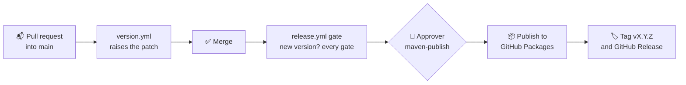

# Maven distribution

How Qeetrix for Android is packaged for apps, how an app installs it, and how a version would be published. The
decision is [0018](../Decisions/0018-maven-distribution.md). **Nothing has been published**: the only repository
this build writes to is a local directory.

## Coordinates

```kotlin
implementation("com.qeetgroup:qeetrix:<version>")
```

`com.qeetgroup` is the group Qeet Group's Gradle projects use; `qeetrix` is the module. The package and Android
namespace are `com.qeetgroup.qeetrix`. The version is `qeetrix.version` in `gradle.properties`, the one the next release publishes; the last candidate is `0.1.0-rc.2`,
which supersedes the unpublished `0.1.0-rc.1` ([RELEASE-POLICY.md](RELEASE-POLICY.md)).

## What a version contains

| File | What |
|:--|:--|
| `qeetrix-<version>.aar` | The release build: classes, two fonts, 85 `qx_` strings and a plural, four licence texts; no permissions or components ([AAR-VERIFICATION.md](AAR-VERIFICATION.md)) |
| `qeetrix-<version>.pom` | Coordinates, name, description, URL, organisation, SCM, and dependencies with exact versions. No `<licenses>` until the owner chooses one ([LICENSE-COMPLIANCE.md](LICENSE-COMPLIANCE.md)) |
| `qeetrix-<version>.module` | Gradle module metadata: an API variant, a runtime variant and a sources variant. Gradle reads this in preference to the POM |
| `qeetrix-<version>-sources.jar` | The Kotlin sources, so IDEs show the KDoc and navigate into components |
| `*.sha256`, `*.sha512` (and `md5`, `sha1`) | Checksums Gradle writes beside each file |

Dependencies an app receives, as published:

| Scope | Artifacts |
|:--|:--|
| API (on the app's compile classpath — public Qeetrix signatures use their types) | `androidx.compose.runtime:runtime`, `androidx.compose.ui:ui`, `androidx.compose.animation:animation-core`, `androidx.compose.foundation:foundation` 1.12.1; `org.jetbrains.kotlin:kotlin-stdlib` 2.4.21 |
| Runtime only | `androidx.compose.material3:material3` 1.4.0 and `androidx.activity:activity` 1.8.2 (the date and time pickers, pull to refresh and the sheets' back handling; no Material type is public); the Compose BOM 2026.09.00 as a platform, aligning the app's Compose artifacts to at least the tested versions |

Everything comes from Google's Maven repository and Maven Central, which every Android app already uses.
`Scripts/verify-publication` checks the coordinates, files, checksums, variants and dependency sources of a
publication.

## Installing it in an app

Requirements, set by Compose 1.12 rather than by Qeetrix: **compile SDK 37** and **AGP 9.1 or newer**; minimum SDK
29. Kotlin 2.3 or newer ([COMPATIBILITY-MATRIX.md](COMPATIBILITY-MATRIX.md)).

```kotlin
// settings.gradle.kts
dependencyResolutionManagement {
    repositories {
        // The repository the owner chooses (below). Restrict it to com.qeetgroup so nothing else can come from it.
        exclusiveContent {
            forRepository { maven { url = uri("<repository URL>") /* and credentials, if it needs them */ } }
            filter { includeGroup("com.qeetgroup") }
        }
        google()
        mavenCentral()
    }
}

// app/build.gradle.kts
dependencies {
    implementation("com.qeetgroup:qeetrix:<version>")
}
```

Then wrap the app's content in `QeetrixTheme { … }`. An app needs no keep rules for Qeetrix, no other Compose
dependency for Qeetrix's sake, no Node.js, Qeetrix npm package or token generator: tokens are compiled into the
library and fonts and strings are in the AAR. This is exactly how the independent consumer in
`Integration/Consumer` is set up, and it is verified on every candidate ([CONSUMER-INTEGRATION.md](CONSUMER-INTEGRATION.md)).

## Building and checking a candidate locally

```sh
Scripts/release-candidate 0.1.0-rc.2 --devices     # every gate; publishes to build/release-candidate/maven only
```

Or the publication alone:

```sh
./gradlew :qeetrix:publishReleasePublicationToReleaseCandidateRepository -Pqeetrix.version=0.1.0-rc.2
Scripts/verify-publication build/release-candidate/maven 0.1.0-rc.2 qeetrix/build/outputs/aar/qeetrix-release.aar
```

## The registry: GitHub Packages

The owner chose **GitHub Packages** on 4 November 2026; the options are compared in
[0018](../Decisions/0018-maven-distribution.md). The repository is public, so the package is public too, which the MIT
licence allows. GitHub's Maven registry still asks for a token to download, even for a public package. An app adds the
repository `https://maven.pkg.github.com/qeetgroup/qeetrix-android` with a GitHub user and a token that has
`read:packages`, kept in `~/.gradle/gradle.properties` or the CI's secrets, never in the app's repository.

Maven Central, which needs no token, is not used for now (the owner's decision, 4 November 2026). It would need proof
that Qeet owns the domain behind the group: for `com.qeetgroup`, `qeetgroup.com`, which nobody had registered on that
date (Qeet's domain is `qeet.in`). Adding it later keeps the same coordinates once that domain is registered, plus a
Sonatype Central account, a signing key, and a `developers` section and a docs jar in the POM.

## Publishing

Qeetrix for Android releases the way every Qeetrix package does (qeetrix-react's decision D-07): **merging to `main`
releases the version in `gradle.properties`.**



1. **Pull request into `main`.** `version.yml` raises the patch of `qeetrix.version` on the pull request's branch,
   so the version is in the diff. Raise the minor or major by hand; a breaking change before 1.0 needs a minor.
2. **Merge.** `release.yml`'s gate checks the version is not already published, then runs every release gate
   (`Scripts/release-candidate`). If the version is unchanged, nothing happens.
3. **Approval.** The publish job waits for an approver in the protected `maven-publish` environment.
4. **Publish.** It verifies the commit again, publishes with the run's own short-lived token (`packages: write`),
   checks the files sent against the verified `SHA256SUMS`, and attests their build provenance. No long-lived
   credential is stored.
5. **Tag and release.** Only after a successful publish, it tags the commit `vX.Y.Z` and opens a GitHub Release from
   the version's CHANGELOG entry, with the AAR, sources, POM, SBOM and checksums attached. A `-rc.N` version is
   marked as a pre-release.

A version is published once. A bad release is withdrawn with `rollback.yml`, and the fix is a new version
([ROLLBACK-PROCEDURE.md](ROLLBACK-PROCEDURE.md)). Anyone can check a downloaded file came from this repository's
workflow with `gh attestation verify <file> --repo qeetgroup/qeetrix-android`.

**One-time setup, before the first release:** in the repository's **Settings › Environments**, create an environment
named `maven-publish` with the owner as a **required reviewer**. Without it, GitHub would create the environment on
the first run with no approval step.

In `qeetrix/build.gradle.kts`, the registry exists only when the workflow passes `-Pqeetrix.registry.url`, and its
credentials are the Gradle properties `registryUsername` and `registryPassword`, which the workflow sets. A local
build, and `Scripts/release-candidate`, still publish only to `build/release-candidate/maven`.
