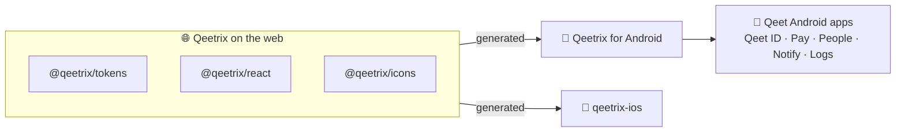

<div align="center">

# 🎨 Qeetrix for Android

**Qeet Group's design system for Jetpack Compose: the Qeetrix look of the web and iOS, as native Android components.**

[](#-getting-started)
[](#-getting-started)
[](#-getting-started)
[](Upstream/manifest.json)
[](LICENSE)
[](#-status)

[📖 Design system](https://ui.qeet.in) · [🧩 Components](Documentation/Components/README.md) · [🏗️ Architecture](ARCHITECTURE.md) · [📝 Changelog](CHANGELOG.md)

</div>

## 📦 What's inside

| | |
|:--|:--|
| 🧩 **64 components** | Buttons, forms, dialogs, sheets, menus and navigation, plus native-only ones such as the OTP code, QR scanner, swipe actions and pull to refresh |
| 🎨 **Foundations** | 109 colour roles in light and dark, 18 text styles, spacing, radii, shadows, motion and three densities |
| ✨ **59 icons** | From `@qeetrix/icons`, in sharp and round shapes, outline and filled |
| 🔤 **Fonts** | Qeet Sans and Fira Code, the same files the web uses |
| 🌐 **Formatting** | Numbers, money, dates, times and durations in the device's locale (`QeetrixFormat`) |
| ♿ **Accessibility** | TalkBack support, 48 dp touch targets, checked contrast, text up to 200 %, right to left |

## 🔗 How it fits

The web's packages are the single source of truth. Android's tokens, fonts and icons are generated from them, never
copied by hand, so a colour or a size is the same on every platform.



## 📍 Status

| Version | State |
|:--|:--|
| `0.1.0-rc.2` | ✅ Release candidate. Passed all ten release checks on 31 October 2026. |
| `0.1.0` | 🚀 Releasing on 9 November 2026, on GitHub Packages ([release notes](Documentation/Releases/RELEASE-NOTES.md)) |

## 🚀 Getting started

**Requirements:** Android 10 (API 29) or newer. Your app needs compile SDK 37, Android Gradle Plugin 9.1+ and
Kotlin 2.3+.

**Install** from GitHub Packages. It needs a GitHub token with `read:packages`, kept in `~/.gradle/gradle.properties`
as `gpr.user` and `gpr.key`. The full steps are in the [release notes](Documentation/Releases/RELEASE-NOTES.md#-install).

```kotlin
// settings.gradle.kts, inside dependencyResolutionManagement { repositories { … } }
maven {
    url = uri("https://maven.pkg.github.com/qeetgroup/qeetrix-android")
    credentials {
        username = providers.gradleProperty("gpr.user").orNull ?: System.getenv("GITHUB_ACTOR")
        password = providers.gradleProperty("gpr.key").orNull ?: System.getenv("GITHUB_TOKEN")
    }
}

// app/build.gradle.kts
implementation("com.qeetgroup:qeetrix:0.1.0")
```

To work on the library beside an app, use it from source instead: `includeBuild("../qeetrix-android")` in the app's
`settings.gradle.kts`, and `com.qeetgroup:qeetrix` without a version.

**Use.** Wrap your UI in `QeetrixTheme`. It follows the device's light or dark setting:

```kotlin
setContent {
    QeetrixTheme {                                  // follows the device's dark-theme setting
        Column(Modifier.background(QeetrixTheme.colors.surfaceCanvas).padding(QeetrixSpace.InsetLg)) {
            QeetrixHeading("Security", level = 1)
            QeetrixText("Passkeys and recovery codes", tone = QeetrixTextTone.Subtle)
        }
    }
}
```

Then build screens from the components. The app owns the state, and Qeetrix draws it:

```kotlin
val email = rememberTextFieldState()
QeetrixCard(title = "Sign-in email", description = "Where receipts are sent") {
    QeetrixTextField(email, label = "Work email", placeholder = "e.g. asha@acme.in")
    QeetrixSwitch(alerts, { alerts = it }, label = "Email alerts")
    QeetrixButton("Save changes", onClick = ::save, loading = saving)
}
```

## 🧩 Components

| Group | Components |
|:--|:--|
| 👆 **Actions** | `QeetrixButton` · `QeetrixIconButton` · `QeetrixCopyButton` · `QeetrixBottomActionBar` |
| ✍️ **Forms** | `QeetrixTextField` · `QeetrixPasswordInput` · `QeetrixSelect` · `QeetrixSearchableSelect` · `QeetrixCheckbox` · `QeetrixRadioGroup` · `QeetrixSwitch` · `QeetrixSlider` · `QeetrixOTPInput` · `QeetrixDateField` · `QeetrixForm` |
| 📊 **Data display** | `QeetrixListItem` · `QeetrixAvatar` · `QeetrixBadge` · `QeetrixChip` · `QeetrixStat` · `QeetrixTimeline` · `QeetrixQRCode` · `QeetrixOTPCode` |
| 💬 **Feedback** | `QeetrixAlert` · `QeetrixProgress` · `QeetrixSpinner` · `QeetrixSkeleton` · `QeetrixSnackbar` · `QeetrixEmptyState` |
| 🪟 **Overlays** | `QeetrixDialog` · `QeetrixBottomSheet` · `QeetrixSideSheet` · `QeetrixMenu` · `QeetrixFullScreenForm` |
| 🧭 **Navigation** | `QeetrixTopAppBar` · `QeetrixTabs` · `QeetrixNavigationBar` · `QeetrixNavigationRail` · `QeetrixSteps` |
| 📐 **Layout** | `QeetrixCard` · `QeetrixAccordion` · `QeetrixSeparator` |

These are the main ones. Every component has its own page, with its options, looks and accessibility, in
[Documentation/Components](Documentation/Components/README.md).

## 📲 Sample app

[`sample/`](sample) shows every component on its own page. The home screen switches the theme, density, right to left
and text size for all of them.

```sh
./gradlew :sample:installDebug
```

## 🔨 Building

You need JDK 17+ and the Android SDK with platform 37.

```sh
./gradlew check                      # lint, tests and the public API check
./gradlew :qeetrix:assembleRelease   # the library, in qeetrix/build/outputs/aar/
```

Every other command is in [CONTRIBUTING.md](CONTRIBUTING.md).

## 📚 Learn more

| | |
|:--|:--|
| 📖 [ui.qeet.in](https://ui.qeet.in) | The Qeetrix design system |
| 🧩 [Components](Documentation/Components/README.md) | A page for each Android component |
| 🏗️ [Architecture](ARCHITECTURE.md) | How the library is generated and built |
| 🤝 [Contributing](CONTRIBUTING.md) | Setting up, commands, adding a component |
| 📝 [Changelog](CHANGELOG.md) | What's in each version |
| 🔒 [Security](SECURITY.md) | What the library touches, and how to report a vulnerability |

## 📜 License

[MIT](LICENSE) © 2026 Qeet Group. The bundled fonts and icons keep their own licences
([notices](Documentation/THIRD_PARTY_NOTICES.md)).

---

<div align="center">

Made with 🧡 by Qeet Group · [⬆️ Back to top](#-qeetrix-for-android)

</div>
