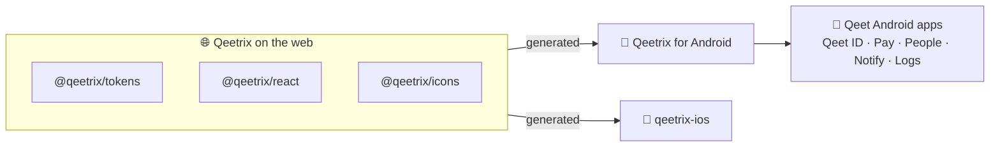

<div align="center">

# 🤖 Qeetrix for Android

**Qeet Group's design system for Jetpack Compose: the Qeetrix look of the web and iOS, as native Android components.**

[](https://github.com/qeetgroup/qeetrix-android/releases/latest)
[](https://github.com/qeetgroup/qeetrix-android/actions/workflows/ci.yml)
[](#-quick-start)
[](#-quick-start)
[](#-quick-start)
[](LICENSE)

[🌐 ui.qeet.in](https://ui.qeet.in) · [🚀 Quick start](#-quick-start) · [🧩 Components](docs/components.md) · [🏗️ Architecture](ARCHITECTURE.md) · [📝 Changelog](CHANGELOG.md)

</div>

## 📦 What's inside

| | |
|:--|:--|
| 🧩 **44 component families** | Buttons, forms, dialogs, sheets, menus and navigation, plus native ones: the OTP code, QR scanner, swipe actions and pull to refresh |
| 🎨 **Foundations** | 109 colour roles in light and dark, 18 text styles, spacing, radii, shadows, motion and three densities |
| ✨ **1,863 icons** | Every `@qeetrix/icons` icon, sharp and round, outline and filled; the components' 100 in the library, the rest in the optional `qeetrix-icons-extended` |
| 🔤 **Fonts** | Qeet Sans and Fira Code, the same files the web uses |
| 🌐 **Formatting** | Numbers, money, dates, times and durations in the device's locale (`QeetrixFormat`) |
| ♿ **Accessible** | TalkBack, 48 dp touch targets, checked contrast, text up to 200 %, right to left |

## 🔗 How it fits

The web's packages are the single source of truth: tokens, fonts and icons are generated from them, never copied by
hand, so a colour or a size is the same on every platform.



## 🚀 Quick start

Android 10 (API 29) or newer; your app needs compile SDK 37, Android Gradle Plugin 9.1+ and Kotlin 2.3+. The library
is on GitHub Packages, read with a GitHub token that has `read:packages` (`gpr.user` and `gpr.key` in
`~/.gradle/gradle.properties`; [the full steps](docs/releases.md#-installing)):

```kotlin
// settings.gradle.kts, inside dependencyResolutionManagement { repositories { … } }
maven {
    url = uri("https://maven.pkg.github.com/qeetgroup/qeetrix-android")
    credentials {
        username = providers.gradleProperty("gpr.user").orNull ?: System.getenv("GITHUB_ACTOR")
        password = providers.gradleProperty("gpr.key").orNull ?: System.getenv("GITHUB_TOKEN")
    }
}

// app/build.gradle.kts
implementation("com.qeetgroup:qeetrix:0.3.0")
implementation("com.qeetgroup:qeetrix-icons-extended:0.3.0") // optional: every other icon; R8 keeps only those used
```

Wrap your UI in `QeetrixTheme` (it follows the device's light or dark setting) and build from the components. The app
owns the state; Qeetrix draws it:

```kotlin
setContent {
    QeetrixTheme {
        val email = rememberTextFieldState()
        QeetrixCard(title = "Sign-in email", description = "Where receipts are sent") {
            QeetrixTextField(email, label = "Work email", placeholder = "e.g. asha@acme.in")
            QeetrixButton("Save changes", onClick = ::save, loading = saving)
        }
    }
}
```

Every component, with its options, looks and accessibility, has a page in [docs/components](docs/components.md).

## 🛠️ Develop

JDK 17+ and the Android SDK with platform 37.

```sh
./gradlew check                      # lint, ktlint, the JVM tests and the public API check
./gradlew :sample:installDebug       # the sample app: every component, with theme, density, RTL and text size
```

Before every push, run the whole local gate (tests with coverage, the release builds, the package and icon-budget
checks, and the device tests when they apply): [CONTRIBUTING.md](CONTRIBUTING.md), "Before you push".

## 🚢 Releases

Work lands on `develop`. A pull request from `develop` into `main` with `qeetrix.version` raised in `gradle.properties`
and a dated [changelog](CHANGELOG.md) entry releases it: merging publishes to GitHub Packages, attests the build's
provenance, tags `vX.Y.Z` and opens a GitHub Release.

## 📚 Learn more

| | |
|:--|:--|
| 🏗️ [Architecture](ARCHITECTURE.md) | How the library is generated and built |
| 🤝 [Contributing](CONTRIBUTING.md) | Setting up, the commands, adding a component |
| 🔒 [Security](SECURITY.md) | What the library touches, and how to report a vulnerability |
| 🍎 [qeetrix-ios](https://github.com/qeetgroup/qeetrix-ios) | The same design system for SwiftUI |

## 📜 Licence

[MIT](LICENSE) © 2026 Qeet Group. The bundled fonts and icons keep their own licences ([notices](docs/third-party.md)).
