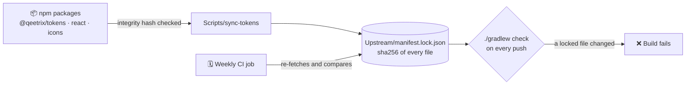

# 🔒 Security

Qeetrix for Android is a UI library. It draws what the app gives it, and nothing more.

| | |
|:--|:--|
| 🌐 **Network** | None. It makes no requests and loads no images. |
| 🔑 **Permissions** | None declared. The QR scanner uses the camera only through the app's own permission. |
| 💾 **Data** | Nothing stored, logged or sent. What a person types stays in state the app owns. |
| 📦 **Ships with** | Compose and AndroidX libraries at locked versions, two font files, licence texts and `qx_` strings. |

## 🛡️ Supply chain

Everything the library is built from is pinned, checked and locked:

- **Upstream packages** are pinned by version in `Upstream/manifest.json`. Each bundled font must also match the
  size, checksum and axes `@qeetrix/tokens` publishes for it.
- **Dependencies** are locked in `qeetrix/gradle.lockfile` (strict mode), so any change is a reviewed diff. The
  Gradle wrapper is pinned by checksum and validated in CI.
- **Gradle dependency verification** (a checksum for every artifact) is not turned on yet. It's recommended once
  publishing runs from CI.

## 🔐 Sensitive input and content

- **Passwords and one-time codes.** `QeetrixPasswordInput` is masked, with copy, cut and suggestions off. Neither it
  nor `QeetrixOTPInput` saves the text or puts it in any label or accessibility text, and a test checks this.
  Password managers still work through AutoFill.
- **Snackbars and dialogs** are shown on screen and read aloud. Never put a password, code or other secret in them.
  A confirmation dialog records a choice and authorises nothing: the code that acts must check permission.
- **Displayed data.** Lists, rows and empty states show only what the app passes. An error state shows the app's
  words or Qeetrix's defaults, never an exception's message.

More detail: [FORMS.md](Documentation/Standards/FORMS.md) and
[DATA_DISPLAY_AND_COLLECTIONS.md](Documentation/Standards/DATA_DISPLAY_AND_COLLECTIONS.md).

## 🚢 Publishing

- **Builds publish only to a local folder.** The one exception is the Release workflow, which runs when a pull
  request is merged to `main` and uploads to GitHub Packages.
- **It waits for an approver** in the protected `maven-publish` environment, and uses the run's own short-lived token;
  no long-lived credential is stored ([MAVEN-DISTRIBUTION.md](Documentation/Releases/MAVEN-DISTRIBUTION.md)).
- **It publishes what it verified.** It runs every release gate first, checks the files it sent against the verified
  checksums, and attests their build provenance (`gh attestation verify`).
- **Every release candidate** records its source commit, toolchain, SHA-256 checksums of every file, and a CycloneDX
  SBOM.
- **Apps should fetch `com.qeetgroup` only from the approved registry** (`exclusiveContent`), as
  `Integration/Consumer` does.

## 📅 Supported versions

| Version | Security fixes |
|:--|:--|
| `main` | ✅ Yes |
| Released versions | None released yet. Once they are, fixes go into a patch of the latest minor version ([RELEASE-POLICY.md](Documentation/Releases/RELEASE-POLICY.md)). |

## 🚨 Reporting a vulnerability

This repository is public, so **don't report a vulnerability in an issue or a pull request.** Anyone can read those.

1. Contact a **repository administrator** privately.
2. Say what you found and its impact.
3. Explain how to reproduce it.
4. Name the commit you tested.

There is no dedicated security contact for this repository yet. Until there is, reports go to the administrators
directly.
