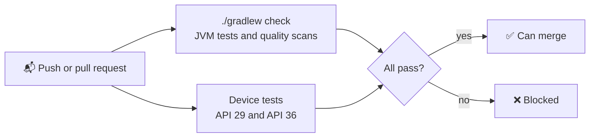

# 🔍 Quality

How Qeetrix for Android is checked, what it promises about its API, and what is still open. Current for `0.1.0`
(4 November 2026). The approach is decided in [0017](decisions.md).

## ✅ Checked automatically

Every push and pull request runs the same gates in CI:

| Check | Where | What it proves |
|:--|:--|:--|
| 🧪 **Behaviour and semantics** | `./gradlew check` (Robolectric, Compose UI Test) | Each component's states, and the names, roles, states and actions TalkBack reads |
| 🌗 **Contrast** | `ComponentContrastTest` | Every colour pair a component draws meets WCAG, in light and dark |
| 👉 **Touch targets** | The quality scans | Every control has 48 dp to tap. Five small-by-design controls take a tap outside their drawing (`TouchLandingTest`). |
| 🔠 **Text clipping** | `LayoutQualityTest` | No text is cut at 200 % text or in right to left |
| 🎞️ **Reduced motion** | The quality scans | Nothing moves when Remove animations is on |
| ♿ **Accessibility Test Framework** | Device tests on API 36 | Google's accessibility checks pass on every component, in light and dark |
| 📸 **Screenshots** | `verifyRoborazziDebug`, on a maintainer's machine | Every component in light, dark, 200 % text and right to left matches its reviewed image |
| 🔌 **Public API** | `apiCheck` | No public signature changes by accident |
| 📊 **Test coverage** | Kover, in CI | At least 92 % of the library's lines run in tests (94.0 % on 4 November 2026). Generated token and icon data are left out. |

Every public composable has a specimen in the
[quality catalogue](../qeetrix/src/sharedTest/kotlin/com/qeetgroup/qeetrix/quality/QualityCatalog.kt), and a test
fails if one is missing, so every scan covers every component.

## 👀 Checked by hand

- **31 October 2026:** every component added for the Android tickets, one by one, on an Android 16 phone emulator in
  light, dark, 200 % text and right to left, then on a tablet emulator. What was found is fixed, each with a test
  ([CHANGELOG](../CHANGELOG.md#fixed-on-the-device-pass)).
- **4 November 2026:** the owner looked through the sample app on an Android 17 phone emulator and found no
  problems.

## 🔌 API compatibility

What counts as a breaking change, and how each kind is caught. The rules for writing API are in
[PUBLIC_API.md](llm/boundaries.md); the baseline is [0013](decisions.md).

| Kind | Breaks when | Caught by |
|:--|:--|:--|
| **Binary** | A JVM signature changes, so a compiled app fails to link | `apiCheck` against `qeetrix/api/qeetrix.api` |
| **Source** | A name or parameter order changes, so an app's code no longer compiles | The sample and the documentation-example tests use only the public API |
| **Behavioural** | A component does or draws something different | Behaviour tests and screenshots. Listed under **Changed** in the CHANGELOG. |
| **Dependency** | An app needs a newer minimum SDK, compile SDK, Compose, AGP or Kotlin | `Scripts/verify-publication` (the POM's dependencies) and the [compatibility matrix](releases.md) |

- **Adding a parameter breaks binary compatibility,** even with a default. Add an overload, or accept the break with a
  CHANGELOG entry and a baseline update. Never regenerate the baseline to hide an unexpected diff.
- **Adding an enum entry** can break an app's exhaustive `when`, so the CHANGELOG says so.
- **No public data classes,** so adding a property never breaks `copy` or `componentN`.
- **Nothing internal leaks:** generated tokens, field parts and layout helpers are `internal`.

## 🚧 Known gaps

Verification not done for `0.1.0`. None is a known defect.

| # | Gap | Status |
|:--|:--|:--|
| G1 | **TalkBack, by a person** | Not done. The owner accepted it as a known gap for `0.1.0` on 4 November 2026. The automated checks cover names, roles and states, not whether the result is easy to follow. |
| G2 | **Switch Access, Voice Access, keyboard and D-pad, by a person** | Not done, as G1 |
| G3 | **Physical devices** | Emulators only (API 29, 36 and 37; phone and tablet) |
| G4 | **Accessibility Test Framework on other API levels and on overlay windows** | Runs on API 36, on the test's own window |
| G5 | **Frame timing** | No performance figure is claimed. There is no benchmark module or Baseline Profile yet. |
| G6 | **Input methods and AutoFill on a device** | East Asian composing and password managers' offers not tried |
| G7 | **Foldables and resizable windows** | Not tried |

## 🔎 Findings

None open. Quality findings Q-1 to Q-14 are fixed or no longer happen, and Q-15 is settled by the spec (below). Each
fix names its finding in a code comment beside it.

## 🌐 Decisions outside this repository

| Decision | Owner | Note |
|:--|:--|:--|
| **Translations** of the built-in strings | Product and localization | English only. No translation was invented. |
| **Increased-contrast colours** | `@qeetrix/tokens` (upstream) | Android follows the web's tokens, which have no high-contrast set yet |
| **Qeet ID Auth** as a consumer | The Qeet ID team | It's a React Native app, so it can't use a Compose library as it stands |

## ✔️ Accepted by design

- **A long OTP code in a narrow column** (Q-15). A 10-character code needs a 312 dp column (328 dp in two groups). The
  spec says a code never goes in a narrower one and a longer code is a single input (settled 30 October
  2026). The quality scans keep one such case to show what happens.
- The navigation bar's labels end in an ellipsis at 200 % text when they don't fit. TalkBack reads them in full.
- In a right-to-left screen, an English paragraph's punctuation follows Compose's default.
