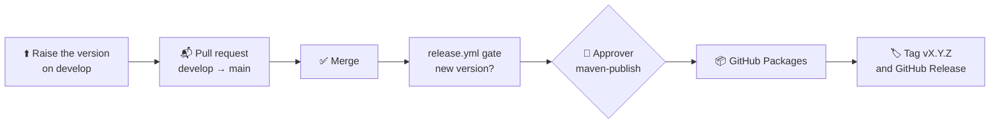

# 🚀 Releases

How versions are numbered, how a release reaches GitHub Packages, how apps install it, and what to do when one is bad.

## 🔢 Versions

[Semantic Versioning](https://semver.org): `MAJOR.MINOR.PATCH`, with release candidates `-rc.N`.

| Release | May change |
|:--|:--|
| Patch `x.y.Z` | Fixes only. No public API change. |
| Minor `x.Y.0` | Additions: components, parameters through new overloads, tokens. **Before 1.0**, also breaking changes, each under **Breaking** in the CHANGELOG with migration steps. |
| Major `X.0.0` | From 1.0: breaking changes, after a deprecation in an earlier minor release |
| Candidate `-rc.N` | A trial of the version before the suffix |

What counts as breaking is in [quality.md](quality.md#-api-compatibility). **1.0** comes once a Qeet app has shipped with
the library.

## 🔁 How a release works

Like every Qeetrix package, **merging to `main` releases the version in `gradle.properties`**:



1. **Raise the version, then the pull request into `main`.** When a change ships (the library's code and resources, its
   build and dependencies, or `Upstream/`), raise `qeetrix.version` on develop: the next patch, or a minor or major.
   The pull request's Release gate fails until it's raised. A docs, tests or CI change needs no new version: merging it publishes nothing.
   Date the CHANGELOG entry (`## [X.Y.Z] — YYYY-MM-DD`): it becomes the GitHub Release's notes.
2. **Merge.** `release.yml` checks the version is new and that `maven-publish` has a required reviewer. It runs no
   checks: `main`'s protection required Verify and the Release gate on the pull request, and the tests ran locally.
3. **Approve.** The publish job waits for an approver: **Actions › Release › Review deployments › Approve**.
4. **Publish.** It builds and verifies the artifacts (`Scripts/release-candidate --tested`: the AAR, the publication,
   the licences, the SBOM), publishes with the run's own short-lived token, checks the files sent
   against the verified checksums, and attests their build provenance.
5. **Tag and release.** Only after a successful publish: the `vX.Y.Z` tag and a GitHub Release with the AAR, sources,
   POM, SBOM and checksums attached. A `-rc.N` version is marked as a pre-release.

A version is published once. Anyone can check a file came from this repository's workflow:
`gh attestation verify <file> --repo qeetgroup/qeetrix-android`.

**The release gates** (`Scripts/release-candidate <version> [--devices]`, which also runs locally): the token drift
check, `./gradlew check` with the AAR, API docs and the minified sample, the AAR's contents, the screenshots where
baselines exist, a local publication and its POM and module metadata, the dependency inventory and SBOM, and, with
`--devices`, the library's device tests. Evidence goes to `build/release-candidate/`.

## 📥 Installing

GitHub Packages asks for a token even for a public package. Create a GitHub
[personal access token (classic)](https://github.com/settings/tokens) with **`read:packages`**, and keep it in
`~/.gradle/gradle.properties`, never in the app's repository:

```properties
gpr.user=<your GitHub username>
gpr.key=<the token>
```

```kotlin
// settings.gradle.kts
dependencyResolutionManagement {
    repositories {
        // Qeetrix comes only from its own repository; everything else from Google and Maven Central.
        exclusiveContent {
            forRepository {
                maven {
                    url = uri("https://maven.pkg.github.com/qeetgroup/qeetrix-android")
                    credentials {
                        username = providers.gradleProperty("gpr.user").orNull ?: System.getenv("GITHUB_ACTOR")
                        password = providers.gradleProperty("gpr.key").orNull ?: System.getenv("GITHUB_TOKEN")
                    }
                }
            }
            filter { includeGroup("com.qeetgroup") }
        }
        google()
        mavenCentral()
    }
}

// app/build.gradle.kts
dependencies {
    implementation("com.qeetgroup:qeetrix:0.3.0")
    // Optional, from 0.3.0: every other @qeetrix/icons icon (docs/icons.md). Always the same version as qeetrix.
    implementation("com.qeetgroup:qeetrix-icons-extended:0.3.0")
}
```

Then wrap the app's content in `QeetrixTheme { … }`. In an app's own GitHub Actions, the `GITHUB_TOKEN` fallback works
once the package grants that repository read access (the package's **Settings › Manage Actions access**). No keep
rules, Node.js or Qeetrix npm package are needed: tokens are compiled in, and fonts and strings ship in the AAR.

**Maven Central** isn't used for now (the owner's decision, 4 November 2026). It would need proof of the domain behind
the group: `qeetgroup.com`, which nobody had registered on that date (Qeet's domain is `qeet.in`), plus a Sonatype
account, a signing key, and a `developers` section and docs jar in the POM.

## ↩️ When a release is bad

A published version is never replaced or deleted: apps pin exact versions, and deleting one breaks their builds.

1. **Stop new adoption.** Run **Actions › Rollback** (`rollback.yml`) with the good and the bad version. After
   approval, it makes the good version GitHub's latest release and marks the bad one withdrawn. Tell the app teams.
2. **Apps go back** by changing `com.qeetgroup:qeetrix:<bad>` to `<good>`.
3. **Fix forward** with a new patch release, and record it in the CHANGELOG.

Delete a version only if it must not be downloaded at all (a leaked secret, material Qeet has no right to ship), by the
owner, in GitHub's package settings.

## 🧩 Compatibility

| An app needs | Why |
|:--|:--|
| **Android 10** (API 29) or newer | The library's minimum SDK |
| **Compile SDK 37** and **Android Gradle Plugin 9.1** or newer | Compose 1.12 requires them (its AAR metadata) |
| **Kotlin 2.3** or newer | The library carries Kotlin 2.4 metadata, which a compiler reads one version back |

Built with AGP 9.5.0, Kotlin 2.4.21, Compose BOM 2026.09.00 and Gradle 9.8.2. Tested on Android 10 and Android 16 phone
emulators and an Android 16 tablet emulator; **no physical device**. The minimum toolchain (AGP 9.1.0, Kotlin 2.3.0)
was built and run for `0.1.0-rc.1`.

## 📦 What's in the package

- **The AAR** holds the code, `qx_`-prefixed resources (two fonts, the strings), four licence texts, and no
  permissions or components. `Scripts/verify-aar` checks this on every build, and fails on anything unexpected.
- **The POM and module metadata** name only Google Maven and Maven Central dependencies, at the locked versions;
  `Scripts/verify-publication` checks them.
- **`qeetrix-icons-extended`**, released with the library at the same version, holds generated icon data only and
  depends on `com.qeetgroup:qeetrix` at that version; `Scripts/verify-publication` checks its POM and metadata too.
- **Licences:** the library is MIT. The bundled fonts are SIL OFL 1.1 and the icons MIT (with Lucide's ISC notice),
  all unmodified, with their texts in the AAR. The runtime dependencies are Apache 2.0. Each release carries a
  CycloneDX SBOM. Details: [third-party-notices.md](third-party.md).

## 📝 0.1.0

**GO, to GitHub Packages** (the owner, 4 November 2026). TalkBack, Switch Access and keyboard use by a person are a
known gap for 0.1.0, not a blocker ([quality.md](quality.md#-known-gaps) G1, G2). The other conditions set at
`0.1.0-rc.2` are met: every gate runs again at release, CI and the device tests pass, and the code is MIT-licensed.

| Candidate | Built | Result |
|:--|:--|:--|
| `0.1.0-rc.2` | 31 October 2026 | 10 of 10 gates; its three defects (the SBOM's font entries, the bottom action bar off a tablet's screen, the form sheet's double dim) fixed since |
| `0.1.0-rc.1` | 20 October 2026, on `@qeetrix/ui` | 10 of 10 gates; superseded by the migration |

Neither candidate was published.
